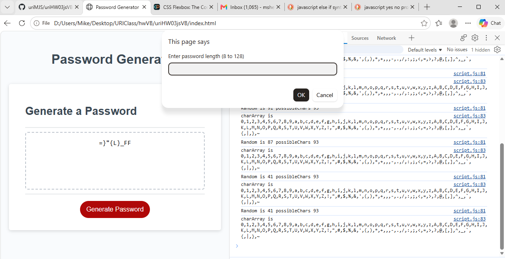

# uriHW03jsVB
Javascript password generator - MJS 10.13.26  

## Links
Deployed HTML Link: "https://urimjs.github.io/uriHW03jsVB/"  
GitHub Repo Link: "https://github.com/uriMJS/uriHW03jsVB.git"   
Screenshot Link:    

## Notes
There is starter code (index.html, style.css, script.js and a .png file) for this project.   
Although the starter code is in a Develop subdirectory, I'm moving the files to root.   
As usual, it seems easiest to start a new repo, clone it, then copy-past all starter code using Windows.   
The programming was pretty straight-forward, especially with the starter code attaching the handler.  
Screenshot Link:   
    - This image seems to only show up in github.  
    - For screenshot ![Text] is just explanatory text.   
For the githubio (deployed page) link:  
    - Go to the Repo  
    - Click Settings (2nd Row of Icons at Top, Far Right)  
    - Click Pages (Column of Icons at Left, 60% Down)  
    - Should Display GitHub Pages Screen  
    - Source: Deploy from a Branch (Middle of Scren)  
    - Branch: Main - Root (Just Below Source)  
 
## Acceptance Criteria  
    Click the button to generate a password - presented with a series of prompts for password criteria  
    prompted for password criteria - select which criteria to include in the password  
    prompted for the length of the password - choose 8 characters to 128 characters  
    asked for character types to include in the password - confirm whether or not to include lower-uppercase, numeric, and/or special chars  
    I answer each prompt - input should be validated and at least one character type should be selected  
    All prompts are answered - a password is generated that matches the selected criteria  
    The password is generated - and is either displayed in an alert or written to the page.  
	
## Significant Features  
This project was not too hard conceptually.  
As usual, it turned out best to create a new repo, clone it, then use Windows to copy-paste all starter code.  
**Javascript** Used much javascript, much of it common.  
    - console.log  
    - for, while   
    - if elseif ...   
    - .split('') (string to characters)  
    - Math.random, Math.floor  
    - About button - onclick vs addEventListener   
    - textArea.value (preferred over .innerHTML)  
**Markdown**  (Really Aggravating)  
	- Two not visible spaces at end of line, for a new line. (Arghh)  
    - /*/*NoSpace/*/* for Bold  
    - Dash<Space>Text for list.  
	    - 2-4 spaces (not tab) per indent.   
        - Must be on a new line. (Arghh)  
**Just To Learn From**  
	- Added a second button (about) in order to learn.   
	- Used addEventListener and/or "onclick" to show an about box.  
**Tools (Aint nothing more important than your tools)**  		
	- Learned to Use CNTL-SHIFT-J to see web browser developer tool.  
	- Console tab helps to track down bugs.  
	